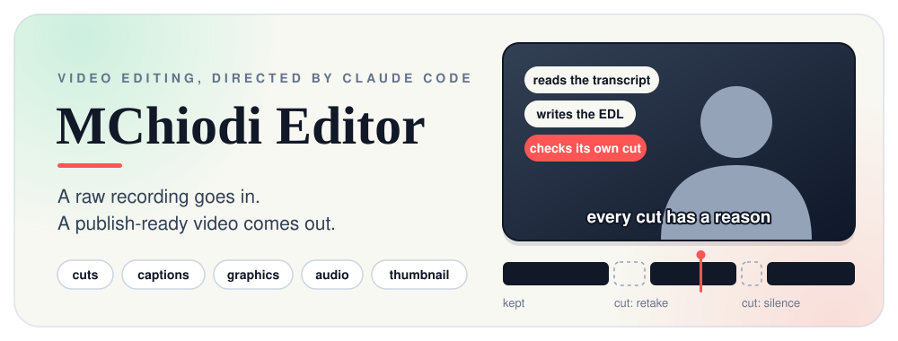
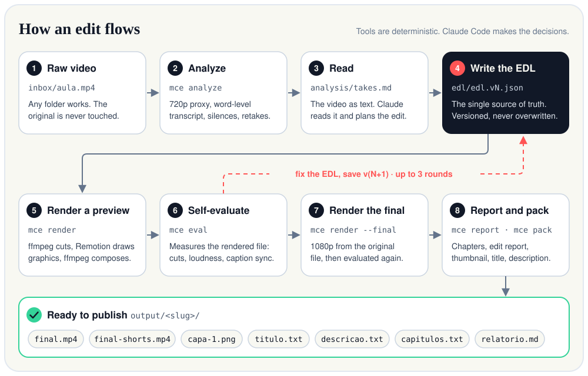
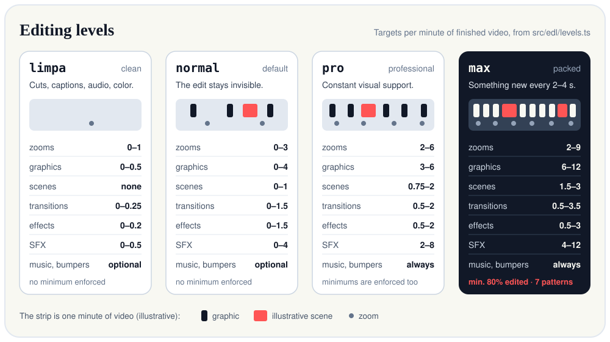
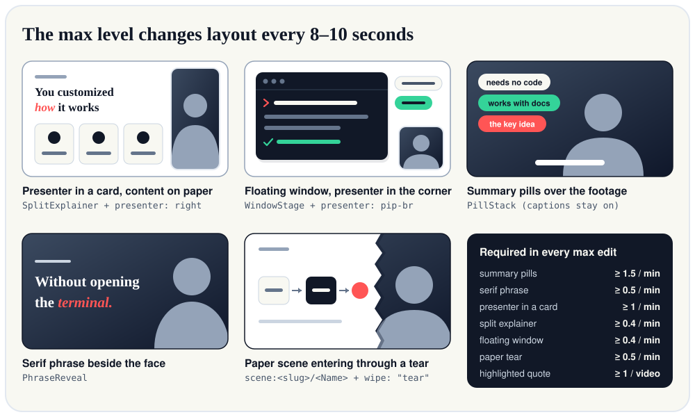
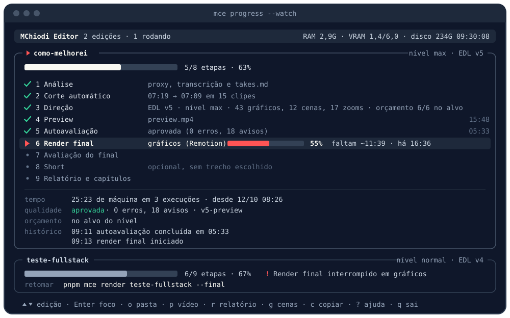
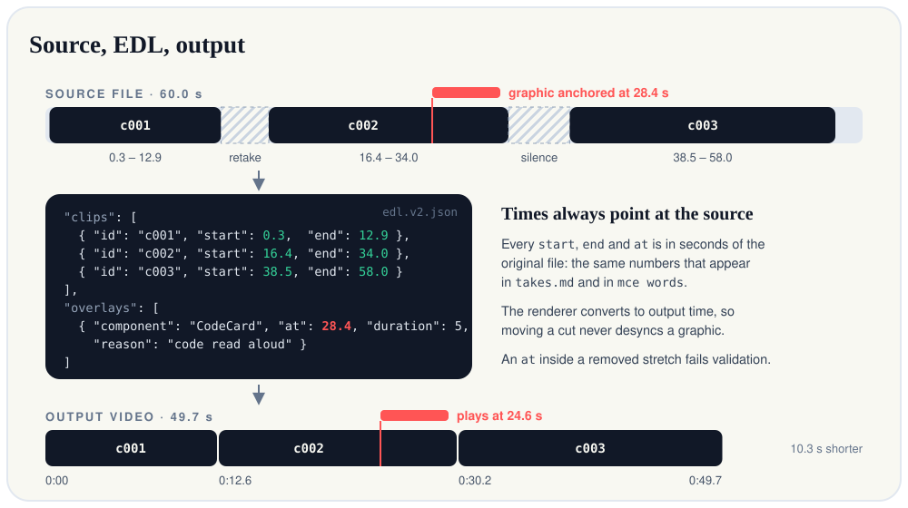

<p align="center">
  
</p>

# MChiodi Editor

**Claude Code edits the videos of the [MChiodi](https://www.youtube.com/@MChiodiDev) YouTube channel end to end.**
You hand it a raw recording; it returns the edited video, a vertical Short, thumbnails, the title, the description,
the chapters and a report explaining every decision.

The repository contains no AI calls of its own. It gives Claude Code three things: a deterministic CLI (`mce`) built on
ffmpeg and Remotion, an arsenal of ready-made motion graphics in the channel's design system, and the skills that teach
the editing process. Claude is the director; the tools only execute.

> **A note on language.** The channel is in Brazilian Portuguese, so the CLI output, the deliverable file names and a
> few identifiers are Portuguese on purpose: `limpa` (clean), `titulo.txt` (title), `descricao.txt` (description),
> `capitulos.txt` (chapters), `relatorio.md` (report), `capa-1.png` (thumbnail). This README keeps them exactly as they
> are in the code and translates each one the first time it appears.

## Contents

- [What it does](#what-it-does)
- [How it works](#how-it-works)
- [Requirements](#requirements)
- [Installation (Windows)](#installation-windows)
- [Quick start](#quick-start)
- [Editing levels](#editing-levels)
- [Following an edit](#following-an-edit)
- [The arsenal](#the-arsenal)
- [Packaging for YouTube](#packaging-for-youtube)
- [MChiodi Cut (visual editor)](#mchiodi-cut-visual-editor)
- [Command reference](#command-reference)
- [Configuration](#configuration)
- [Project layout](#project-layout)
- [The EDL in 60 seconds](#the-edl-in-60-seconds)
- [Troubleshooting and FAQ](#troubleshooting-and-faq)
- [Development](#development)
- [Limitations](#limitations)
- [License and credits](#license-and-credits)

## What it does

**In:** one video file (`.mp4`, `.mov`, `.mkv`, `.m4v`, `.webm` or `.avi`), anywhere on disk. The original is never
moved, modified or deleted.

**Out:** a folder `output/<slug>/`, where `<slug>` is derived from the file name:

| File | What it is |
|---|---|
| `final.mp4` | The edited video at 1080p: cuts, animated captions, motion graphics, transitions, color and audio treatment |
| `final-shorts.mp4` | A vertical 9:16 Short of up to 60 s, when the video has a good stretch for one (optional) |
| `capa-1.png`, `capa-2.png`, ... | Thumbnails, 1280x720. `capa-1.png` is the recommended one; the others are for A/B testing |
| `capas.png` | All thumbnails side by side at 640, 320 and 168 px, to judge them at phone size |
| `titulo.txt` | Titles: the recommended one first, then alternatives for A/B testing, each with its reasoning |
| `descricao.txt` | Description, with the chapters already inserted |
| `tags.txt` | Search tags |
| `capitulos.txt` | Chapters with timestamps, ready to paste |
| `relatorio.md` | Report: what was cut, what was added and why, what the evaluation found |

Your videos never get committed: `inbox/`, `projects/`, `output/`, `mce.config.json` and every media extension are in
`.gitignore`.

## How it works

<p align="center">
  
</p>

Two ideas hold the whole thing together.

**Claude reads the video as text.** It does not watch frame by frame. `mce analyze` turns the recording into
`takes.md`: a word-level transcript with source timestamps, pauses, retakes, hesitations and cut suggestions. Claude
only asks for pictures at decision points.

| Channel | What Claude gets | Where it comes from |
|---|---|---|
| What you say | Local word-level transcript with pauses, retakes and hesitations marked | `projects/<slug>/analysis/takes.md` |
| What is on screen | A strip of frames + waveform + words for a time range, or a single frame | `mce view`, `mce frame` |
| How it sounds | Measured silences, loudness, energy around each cut | `mce analyze`, `mce eval` |

**The EDL is the single source of truth.** Every decision lives in one JSON file, the edit decision list
(`projects/<slug>/edl/edl.vN.json`). Nothing is ever edited "on the side" with loose ffmpeg commands, and an EDL is
never overwritten: each change is saved as the next version with a note saying what changed and why. After rendering,
Claude runs `mce eval` on the result, reads the findings, fixes the EDL and renders again, for up to three rounds.

Under the hood, ffmpeg cuts the footage in a single pass, Remotion renders the graphics as one transparent layer, and
ffmpeg composes both, treats the audio and encodes (NVENC when available, libx264 otherwise). The footage itself never
goes through a browser. The engineering decisions and the measurements behind them are in [`CLAUDE.md`](CLAUDE.md).

## Requirements

| What | Notes |
|---|---|
| Windows 11 | The only platform it has been built and tested on. The global command and the transcription environment are Windows-specific |
| [Claude Code](https://claude.com/claude-code) | Logged in. It is the director |
| Node.js 22 or newer | Developed on Node 24. pnpm via Corepack |
| ffmpeg, "full" build | Needs `libass`, `xfade`, `afftdn` and, for GPU encoding, `h264_nvenc` |
| [`deep-filter`](https://github.com/Rikorose/DeepFilterNet/releases) (optional) | Neural voice denoise for `audio.denoise: "deepfilter"`. Rename the release `.exe` to `deep-filter.exe` and put it on `PATH`, or point `denoise.deepFilterPath` / `MCE_DEEPFILTER` to it. Without it, the render falls back to `afftdn` |
| [uv](https://docs.astral.sh/uv/) | Manages the Python 3.12 used for transcription. Your system Python is not used |
| NVIDIA GPU (recommended) | Transcription defaults to CUDA. CPU works with a config change, much slower |
| Disk space | The transcription environment (WhisperX + PyTorch with CUDA) takes several GB; each project stores a proxy and its renders |

Chrome does not need to be installed for rendering: Remotion downloads its own on first use.

## Installation (Windows)

All commands are PowerShell.

**1. Node and pnpm**

```powershell
winget install OpenJS.NodeJS.LTS
corepack enable
```

**2. ffmpeg**

```powershell
winget install Gyan.FFmpeg
```

**3. uv** (then open a new terminal so `uv` is on your PATH)

```powershell
winget install --id astral-sh.uv -e
```

**4. Project dependencies**

```powershell
cd D:\path\to\mchiodi-editor
pnpm install
```

**5. Transcription environment**

```powershell
cd transcriber
uv python install 3.12
uv sync --python 3.12
cd ..
```

**6. Base sound effects** (synthesized locally, royalty-free)

```powershell
pnpm mce assets init
```

**7. Global `mce` command** (optional, recommended)

```powershell
pnpm run install-cli
```

`pnpm mce ...` only works inside the project folder. This step writes `mce.cmd` and `mce.ps1` into
`%USERPROFILE%\.local\bin` or `%USERPROFILE%\bin`, whichever is already on your PATH, so that `mce ...` works from any
folder. After that, **every command written as `pnpm mce ...` in this README also works as `mce ...`**, and relative
paths resolve from where you are:

```powershell
cd D:\recordings
mce analyze ".\hooks lesson.mp4"
mce progress --watch
```

- The installer does not touch your PATH or the registry. If neither folder is on the PATH, it stops and tells you what to add.
- If you move or rename the project folder, run `pnpm run install-cli` again. To remove it: `pnpm run uninstall-cli`.
- `mce.ps1` is only created when your PowerShell execution policy allows local scripts (`RemoteSigned`, the usual
  setting). Without it PowerShell falls back to `mce.cmd`.

### Verify your setup

```powershell
pnpm typecheck          # TypeScript compiles
pnpm test               # unit tests + ffmpeg integration tests on synthetic media
pnpm mce assets list    # sfx: click.wav, ding.wav, glitch.wav, pop.wav, whoosh.wav
pnpm mce arsenal        # counts per category of the arsenal
pnpm mce levels         # the four editing levels
pnpm mce doctor         # ffmpeg, ffprobe, deep-filter (optional) and GPU
```

The first transcription downloads the Whisper `large-v3` model and the Portuguese alignment model, so it takes longer
than the following ones.

## Quick start

There are three ways to get a video edited. Pick one.

### a) Talk to Claude Code

Open Claude Code in the project folder and ask in plain language:

```text
edit the video D:\recordings\hooks-lesson.mp4 at the pro level
```

Claude follows the `edit-video` skill: it analyzes, tells you the strategy, writes the EDL, renders a preview,
evaluates it, fixes what it found and delivers. Corrections such as "too much zoom at the start" or "remove that meme"
become a new EDL version and are recorded in the project's notes, so they are not lost between sessions.

The first time you open Claude Code here, accept the folder trust dialog: the permissions in `.claude/settings.json`
(running `pnpm mce`, tests, `ffprobe`) only apply after that.

### b) One command, unattended

```powershell
pnpm mce send "D:\recordings\hooks-lesson.mp4" --level max
```

This edits the file where it is (nothing is copied or moved) and produces the whole package: video, thumbnails,
title, description, chapters and report. It starts a `claude -p` session restricted to the project's tools, with
nobody to answer questions. Follow it from another terminal with `pnpm mce progress --watch`.

### c) Drop files in a folder

```powershell
pnpm mce watch
```

Leave this running and drop videos into `inbox/`. Each new file is edited in turn, one at a time. Subfolders choose the
level: `inbox/limpa/`, `inbox/normal/`, `inbox/pro/`, `inbox/max/` (they are created when the watcher starts); a file at
the root of `inbox/` uses the default level.

```powershell
pnpm mce queue            # state of the queue
pnpm mce queue --retry    # put failed jobs back in the queue
pnpm mce watch --once     # process what is queued, then exit
```

Things to know about unattended mode:

- **Logs.** The session log is `projects/<slug>/headless.log`; the outcome of each job is appended to `output/notificacoes.log`.
- **Phone notification.** Install the [ntfy](https://ntfy.sh) app, choose a topic name that is hard to guess and set
  `"notify": { "ntfyTopic": "<your-topic>" }` in `mce.config.json`. Without a topic, only the local log is written.
- **Authentication.** The session uses your Claude Code login. If `ANTHROPIC_API_KEY` is set in your environment it is
  removed for the session by default, because it would otherwise take precedence over your subscription. To use the key
  instead, set `"headless": { "useApiKey": true }`.
- **Isolation.** The session loads only project and local settings, so your global hooks and instructions do not leak into it.
- **Screen recordings.** A file named `lesson.tela.mp4` or `lesson.screen.mp4` is treated as the screen recording that
  accompanies `lesson.mp4` and is not queued as a video of its own.
- **Time limit.** An edit that runs longer than `headless.timeoutMin` (240 minutes by default) is aborted and marked as failed.

## Editing levels

You choose how much zoom, graphics, illustrative scenes, transitions, effects and sound design a video gets. The level
changes the *amount*, not the taste: the rules for cuts, captions, identity, audio and color apply to all four.

<p align="center">
  
</p>

| Per minute of finished video | `limpa` (clean) | `normal` (default) | `pro` (professional) | `max` (packed) |
|---|---|---|---|---|
| Zooms (camera effects count) | 0–1 | 0–3 | 2–6 | 2–9 |
| Graphics | 0–0.5 | 0–4 | 3–6 | 6–12 |
| Illustrative scenes | none | 0–1 | 0.75–2 | 1.5–3 |
| Transitions | 0–0.25 | 0–1.5 | 0.5–2 | 0.5–3.5 |
| Effects | 0–0.2 | 0–1.5 | 0.5–2 | 0.5–3 |
| Sound effects | 0–0.5 | 0–4 | 2–8 | 4–12 |
| Minimum gap: zoom / graphic / scene / transition | 45 / 30 / n/a / 60 s | 20 / 12 / 60 / 20 s | 10 / 6 / 30 / 10 s | 6 / 4 / 20 / 6 s |
| Different transitions / high-energy ones per video | 1 / 0 | 3 / 3 | 6 / 6 | 10 / 10 |
| Music and intro/outro bumpers | optional | optional | always | always |
| Longest stretch with nothing new on screen | not enforced | not enforced | not enforced | 8 s |
| Share of the video that must be edited | not enforced | not enforced | not enforced | at least 80% |

The numbers live in [`src/edl/levels.ts`](src/edl/levels.ts) and are mirrored, with the reasoning, in
[`STYLE.md`](STYLE.md) section 0. In `pro` and `max` the minimums are enforced as well as the maximums: the evaluation
warns `abaixo-do-nivel` (below the level) or `acima-do-nivel` (above the level).

How to choose a level:

- **In conversation:** "edit X at the pro level". Aliases such as `clean`, `professional`, `profissional` and `lotada` are understood.
- **Unattended:** `pnpm mce send <video> --level max`, or drop the file in `inbox/max/`.
- **As the default:** `"edit": { "level": "pro" }` in `mce.config.json`. Without it, `normal`.
- **On a project already edited:** `pnpm mce level <slug> max` saves a new EDL version at that level; then ask Claude to fill it in.

Two commands show where you stand:

```powershell
pnpm mce levels max       # targets, limits and guidance for a level
pnpm mce level <slug>     # what the project has of each thing versus what its level asks for
```

### The `max` level

`max` is a different visual language, not just more of everything. Something new appears on screen every 2 to 4
seconds, the layout changes roughly every 8 to 10 seconds, and when the screen is taken over by content the presenter
is never cut away: the footage itself shrinks into a card and grows back.

<p align="center">
  
</p>

Seven patterns are mandatory. The evaluation warns `padrao-obrigatorio` (required pattern) for each one below its minimum:

| Pattern | Minimum | When | How it enters the EDL |
|---|---|---|---|
| Summary pills | 1.5 / min | Over the talking head, one per idea, the last one in coral | `PillStack` |
| Serif phrase | 0.5 / min | The thesis of a block, beside the face | `PhraseReveal` |
| Presenter in a card | 1 / min | Whenever the full frame is content | `presenter` on the overlay |
| Split explainer | 0.4 / min | Enumeration, comparison, definition | `SplitExplainer` + `presenter: right` |
| Floating window | 0.4 / min | Demonstration: a command, a tool's answer, the screen recording | `WindowStage` + `presenter: pip-br` |
| Paper tear | 0.5 / min | Entrance of a full-screen illustrative scene | `"wipe": "tear"` on the scene |
| Highlighted quote | 1 / video | The official source of a claim | `DocQuote` |

Per-minute minimums round down and are never less than one occurrence per video.

**The 80% rule.** At least 80% of a `max` video must be edited, from start to finish. A stretch counts as "not edited"
when more than 8 seconds pass with nothing new on screen. Those stretches are deliberate breathers (you talking through
a personal point, or showing something that has to be seen whole): each lasts at most 40 seconds, together they stay
under 20% of the video, and two never sit back to back. The evaluation warns `pouco-editado` (under-edited) below 80%
and `tela-parada` (static screen) for a stretch longer than 40 seconds. A screen recording counts as edited only when it
is inside a `WindowStage` with zooms, pills and the presenter in the corner.

The full analysis of the reference video this language was measured from is in
[`docs/referencia-max.md`](docs/referencia-max.md) (in Portuguese). Only the language is borrowed: no artwork, text or
branding from it.

## Following an edit

### The terminal dashboard

Open a second terminal and leave this running:

```powershell
pnpm mce progress --watch              # live dashboard with every edit, rereads the disk every second
pnpm mce progress <slug> --watch       # opens focused on one project
pnpm mce progress --watch 5            # reread every 5 seconds
pnpm mce progress --watch --no-bell    # no terminal bell when a step finishes
pnpm mce progress                      # print once and exit
```

<p align="center">
  
</p>

Each edit is a card with an overall bar and nine steps: `Análise` (analysis), `Corte automático` (automatic cut),
`Direção` (direction), `Preview`, `Autoavaliação` (self-evaluation), `Render final`, `Avaliação do final` (evaluation
of the final), `Short` and `Relatório e capítulos` (report and chapters). A finished step shows how long it took; the
running one shows a bar, the percentage, the time remaining and the time elapsed.

| Key | Action |
|---|---|
| `↑` `↓` or `k` `j` | Select an edit |
| `Enter` | Toggle between focus (the selected edit with all steps and details) and the overview; `Esc` goes back |
| `o` | Open `output/<slug>` in Explorer |
| `p` | Play the most recent video (`final.mp4`, or the newest preview) |
| `r` | Open `relatorio.md` |
| `e` | Open the project folder `projects/<slug>` |
| `g` | Open the scene viewer in the browser, if it is running |
| `c` | Copy the suggested next command to the clipboard |
| `?` | Show or hide the key help |
| `q` or `Ctrl+C` | Quit |

The dashboard also shows:

- **Machine health** in the header: free/total RAM, used/total VRAM (from `nvidia-smi`) and free disk space. It turns
  red below 2 GB of free RAM or 10 GB of free disk.
- **For the focused edit:** machine time spent, the last evaluation with its first findings, the level budget lines
  that are off target, and the history from `projects/<slug>/activity.log`.
- **The unattended queue**, when there is one: pending, running and failed jobs.
- **Layout that adapts** to the window size, and no color when the output is redirected or `NO_COLOR` is set.

While directing, Claude reports what it is doing with `mce doing`, which is what you see in the `Direção` step.

### The scene viewer

Illustrative scenes are React components, so you can watch them being built:

```powershell
pnpm mce scenes watch <slug>     # start the viewer and open Chrome on the project's most recent scene
pnpm mce scenes open <slug>      # reopen Chrome on a viewer that is already running
pnpm mce scenes stop             # shut everything down and free the RAM
```

The viewer is this project's **Remotion Studio** (live player, timeline, hot reload) plus a watcher on
`motion/src/scenes/`: a scene that is created or deleted shows up in the sidebar by itself, and every save reloads the
player. Under `Roteiros/Roteiro-<slug>` all the scenes of a project play in sequence.

Next to it, on the following port, runs a lightweight index (`http://127.0.0.1:4174/?projeto=<slug>` with the default
port): one card per scene with its description, its timing keys, a link to the Studio and the snippet ready for the
EDL. With `--previews strip` or `--previews video` it also renders a frame strip or a looping preview per scene, one at
a time, pausing while a main render is running.

In unattended mode the viewer starts by itself at the beginning of each edit (`preview.autoOpen`). The Studio holds RAM
for as long as it is open: on a tight machine, run `pnpm mce scenes stop` before the final render.

`pnpm studio` opens the plain Remotion Studio with every component, entrance, transition, effect and scene.

## The arsenal

Everything Claude can put on screen already exists, in the channel's
[design system](https://claude.ai/artifact/BXXD2jJbwCUuft7BsZw3oq): paper, ink, one coral accent, a serif for titles
and a sans for the rest. The rule is **arsenal first**: consult it before creating anything.

| Category | Count | Where | How it enters the EDL |
|---|---|---|---|
| Video components | 55 | `motion/src/components/` | `overlays[].component` |
| Entrance effects | 50 | `motion/src/arsenal/entrances.ts` | `TextReveal` (`props.entrance`) and inside components |
| Transitions | 50 | `src/arsenal/transitions.ts` | `transitions[].type` |
| Video effects | 50 | `src/arsenal/effects.ts` | `effects[].preset` |
| Animation models | grows with every video | `motion/src/scenes/modelos/` | `scene:modelos/<Name>` |
| Bespoke illustrative scenes (the exception) | per project | `motion/src/scenes/<slug>/` | `scene:<slug>/<Name>` |

```powershell
pnpm mce arsenal                        # totals per category
pnpm mce arsenal components -v          # every component with an example of its props
pnpm mce arsenal transitions -s calm    # text search inside a category
pnpm mce arsenal -s glitch              # search across all categories
pnpm mce gallery                        # contact sheets (PNG mosaics) of components and scenes
pnpm mce still <Composition> --frame 45 # one frame of any composition, to check the look
```

Transitions come in two kinds: `xfade` blends the picture from both sides of the cut, and `stinger` is a curtain in the
brand colors that covers it. Scenes are built from two kits in `motion/src/scene-kit/`: the paper kit by default, and
a voxel kit for analogies and playful moments.

When the narration needs something the arsenal does not have, Claude delegates to the **`motion-designer`** sub-agent
([`.claude/agents/motion-designer.md`](.claude/agents/motion-designer.md)), which reads the design system, writes the
component, tests it and looks at stills of its own work before handing it back.

### Animation models

Every animation created for a video is born as a reusable **model** (`modelo`): a file in
`motion/src/scenes/modelos/<Name>.tsx` that draws a *shape* (a stack in two groups, a two-step cycle, a step with a
gap) and receives all of its content through props. In the next video the same animation enters with different text:
`"component": "scene:modelos/<Name>"` and new props in the EDL. The library starts empty and grows with every edit.

```powershell
pnpm mce arsenal models -s comparação -v                    # search by shape; -v shows the slots and the EDL snippet
pnpm mce scenes new <Name> --tags lista,ciclo --from <slug> # scaffold a new model from the template, then sync
pnpm mce scenes audit <slug>                                # scenes without a model, and how much each model is used
```

- **Contract.** No text, number or label of a specific video in the code; a variable number of items; and, in the
  component's `entry`, as literals: `description`, `tags`, `slots`, `origin`, a generic `sample` and `defaultDuration`.
  The name describes the shape, never the subject.
- **Link.** A scene that stays in a video's own folder declares which model it is an instance of:
  `export const MODEL = '<Name>';`. Without it, it is a "scene without a model".
- **Enforcement.** `mce eval` warns `cena-sem-modelo` (scene without a model) for each such overlay,
  `mce scenes audit <slug>` exits with code 2, and `relatorio.md` gets a "Modelos" section.

## Packaging for YouTube

After the report, the **`packager`** sub-agent ([`.claude/agents/packager.md`](.claude/agents/packager.md)) reads the
video, does a short research pass on the topic, proposes three titles and three thumbnails, looks at the thumbnails at
phone size and redoes them until one is good. Its rule: everything the packaging promises, the video delivers. In
unattended mode this happens automatically; in conversation, ask for it:

```text
make the thumbnail, title and description for <slug>
```

The tools it uses:

```powershell
pnpm mce pack frames <slug> -n 12          # thumbnail frame candidates + a numbered contact sheet
pnpm mce pack thumb <slug> --spec <json>   # output/<slug>/capa-<n>.png (1280x720) + capas.png
pnpm mce pack check <slug> --spec <json>   # checks titles, thumbnail text, hook, chapters, links, hashtags
pnpm mce pack write <slug> --spec <json>   # output/<slug>/titulo.txt, descricao.txt and tags.txt
pnpm mce pack layouts                      # face-right | face-left | band | split | number
```

All four take the same spec, `projects/<slug>/pack/pack.json`, with `titles`, `thumbs`, `description` and `tags`; a
full example is in the agent file. The thumbnail is the Remotion composition `Thumbnail` (folder "Capa" in the Studio):
a frame of the video, two to four words with one of them in coral and at most one supporting element (pill, arrow or
badge). Whatever the agent cannot know for certain, such as links and social handles, is written as
`[PREENCHER: ...]` ("fill in") in the description for you to complete. It never invents a link, a number or a sponsor.

## MChiodi Cut (visual editor)

A local "CapCut" over the EDL, to open, adjust and export what `mce` produced, with Claude Code inside the editor:
timeline (clips, captions, overlays, zooms, transitions, waveform and words), preview (light proxy + the real Remotion
graphics layer), word-by-word caption editing with `.srt` export/import, arsenal inserts with a schema-generated form,
level, versions/diff, render/eval and a Claude panel. 100% local and offline: no account, no upload, no telemetry.

```powershell
pnpm cut:build                    # build the UI once (cut/dist); fonts are bundled, so it works offline
pnpm mce cut <slug>               # server on 127.0.0.1 (first free port from 4870) + opens the browser
pnpm mce cut <slug> --no-open     # same, without opening the browser; `pnpm mce cut` alone lists the projects
pnpm cut:dev                      # UI development (Vite, proxies /api to a running mce cut)
```

Principles:

- **The EDL is the truth.** The editor has no editing state of its own and never processes video on the side. Every
  change becomes `edl.v(N+1).json` (same logic as `mce edl save`); the final render is always `mce render`.
- **Snap to measured silence.** Trimming or moving a clip edge always lands in a pause with measured silence, never
  inside a word: dragging into a word shows a warning and snaps to the nearest pause.
- **`Matheus:` notes are decisions.** Versions saved from the editor get notes like
  `Matheus: moveu início de c012 +0.18s; corrigiu legenda 'reakt'→'React'`. The `edit-video` skill treats them as your
  decisions: Claude does not undo them unless you ask, `mce edl save` warns when a new version reverts one, and the
  Claude panel shows the same warning in the proposal's diff.

## Command reference

`mce` alone lists the commands; `mce scenes`, `mce edl`, `mce assets` and `mce pack` list their subcommands;
`mce <command> --help` shows every flag. `<slug>` is the project name, by default the file name in kebab-case.

**Analyze and inspect**

| Command | What it does |
|---|---|
| `mce analyze <video> [-p <slug>] [-f]` | 720p proxy, word-level transcript, silences, retakes, loudness; writes `analysis/takes.md`. `-f` redoes the proxy and the transcript |
| `mce status <slug>` | Where the project stands and what the next step is |
| `mce doctor` | Checks the external tools: ffmpeg, ffprobe, `deep-filter` (optional) and the GPU. Exit code 2 when a required one is missing |
| `mce view <slug> --from <s> --to <s> [-v <n>]` | PNG of a stretch of the source: frames, waveform, words and what the EDL keeps or cuts |
| `mce frame <slug> --at <s>` | One frame of the source |
| `mce words <slug> --from <s> --to <s>` | Words with exact timestamps |

**Direct**

| Command | What it does |
|---|---|
| `mce draft <slug> [-l <level>]` | New EDL version with only the automatic cut and captions |
| `mce levels [level]` | List the levels, or show the targets, limits and guidance of one |
| `mce level <slug> [level] [-v <n>]` | The project's budget at its level; with a level, saves a new EDL version at that level |
| `mce edl list <slug>` | EDL versions with duration, level, counts and notes |
| `mce edl validate <file>` | Validate an EDL file without saving |
| `mce edl save <slug> <file>` | Validate and save as the next version (`edl.vN.json`) |
| `mce edl diff <slug> <a> <b>` | Differences between two versions |
| `mce doing <slug> "<text>" [--percent <n>] [--done]` | Claude reports what it is doing; shown in the dashboard |
| `mce note <slug> "<text>" [-k decisao\|correcao\|pendencia]` | Dated note (decision, correction or pending item) in `projects/<slug>/project.md` |

**Render and evaluate**

| Command | What it does |
|---|---|
| `mce render <slug> [--final] [--shorts] [--no-overlay] [-v <n>]` | Run the EDL: fast preview by default, `--final` for full quality from the original file, `--shorts` for the vertical cut, `--no-overlay` for cuts and audio only |
| `mce eval <slug> [--final] [--no-transcribe] [--views <n>] [-v <n>]` | Evaluate the *rendered* video: cuts, clicks, loudness, caption sync, level budget, plus images to check. Exit code 2 when it fails |
| `mce shorts suggest <slug> [--count 3] [--min 20] [--max 60] [--apply <n>] [-v <n>]` | Rank stretches of the current edit for the Short (deterministic score split into hook, closure, density, clean speech, tech terms, self-containment, length; edges only at EDL cuts or measured silence) → `analysis/shorts-candidates.json`; `--apply <n>` saves candidate n as `shorts` in a new EDL version. `mce shorts <slug>` is the same |
| `mce broll index` | Scan `assets/broll/` (ffprobe) and write `assets/broll/index.json`: file, tags (from folder and file name, accent-free PT-BR stems), duration, resolution, source and license. Manual tags and license survive a re-scan |
| `mce broll suggest <slug> [--apply] [-v <n>]` | Spoken stretches that ask for b-roll (concrete object/place/action or tech mentioned, long stretch without graphics), never over a graphic or screen recording, within the EDL level's budget, matched to the library by tags and simple synonyms → `analysis/broll-candidates.json` (source seconds, trigger word, `reason`, file or "missing: search <term>"); `--apply` saves the ones with a file as `broll` in a new EDL version |
| `mce broll fetch <slug> [-n 5]` | Only with `PEXELS_API_KEY`: download short HD videos (Pexels License) for the missing terms into `assets/broll/pexels/` and record author/license in the index. Without the key it says so and exits 0 |
| `mce export <slug> [-f 16x9\|9x16\|1x1] [--fit blur-pad\|center-crop] [--focus <0-1>] [--shorts] [-v <n>]` | Export for phones through the EDL render (mobile bitrate cap) → `renders/<slug>-<format>.mp4` + `.srt` beside it; `--shorts` exports the `edl.shorts` stretch through the Short render |
| `mce report <slug>` | Write `relatorio.md` and `capitulos.txt` |
| `mce retention import <slug> <file.csv> [-v <n>] [--duration <s>]` / `mce retention lessons` | Import the YouTube Studio retention CSV (EN/PT): drops and rewatch spikes mapped to source time, clip, chapter, graphics and speech → `analysis/retention.json`, `project.md`, `relatorio.md`; `lessons` aggregates patterns across all projects |

**Arsenal and scenes**

| Command | What it does |
|---|---|
| `mce arsenal [kind] [-s <text>] [-v]` | Catalog: `components`, `models`, `entrances`, `transitions`, `effects` |
| `mce gallery [-s <text>] [--at <0-1>]` | Contact sheets of components and scenes in `projects/.gallery/` |
| `mce still <composition> [--frame <n>] [-o <file>]` | Render one frame of a Studio composition |
| `mce scenes sync` | Regenerate the scene index for the Remotion bundle |
| `mce scenes new <Name> [--tags a,b] [--from <slug>[/Scene]]` | Scaffold a reusable animation model |
| `mce scenes audit [slug]` | Scenes without a model and usage of each model. Exit code 2 when something is pending |
| `mce scenes watch [slug] [--port <n>] [--no-open] [--previews off\|strip\|video] [--force]` | Start the scene viewer |
| `mce scenes open [slug]` / `mce scenes stop` | Reopen the browser / shut the viewer down |
| `mce assets init [-f]` / `mce assets list` | Generate the base sound effects / list music, SFX, memes, LUTs and brand files |

**Package and automate**

| Command | What it does |
|---|---|
| `mce pack frames\|thumb\|check\|write\|layouts` | See [Packaging for YouTube](#packaging-for-youtube) |
| `mce send <video> [-l <level>] [--queue-only]` | Full unattended edit of one file; `--queue-only` leaves it for a running `mce watch` |
| `mce watch [--once]` | Watch `inbox/` and edit each new video, one at a time |
| `mce queue [--retry]` | Show the queue; `--retry` requeues failed jobs |
| `mce progress [slug] [-w [seconds]] [--no-bell]` | The dashboard |
| `mce cut [slug] [--port <n>] [--no-open]` | Open the [MChiodi Cut](#mchiodi-cut-visual-editor) visual editor; without a slug, list the projects |

**pnpm scripts**

| Script | What it does |
|---|---|
| `pnpm mce ...` | The CLI, from the project folder |
| `pnpm studio` | Remotion Studio |
| `pnpm cut:build` / `pnpm cut:dev` | Build the MChiodi Cut UI (`cut/dist`) / run it in development |
| `pnpm watch` | Same as `pnpm mce watch` |
| `pnpm test` / `pnpm typecheck` | Vitest / `tsc --noEmit` |
| `pnpm run install-cli` / `pnpm run uninstall-cli` | Install or remove the global `mce` command |

## Configuration

Create `mce.config.json` at the project root. Every key is optional; the defaults are in
[`src/config.ts`](src/config.ts). The file is ignored by git because the ntfy topic works like a password.

```json
{
  "edit": { "level": "pro" },
  "render": { "remotionConcurrency": 2 },
  "notify": { "ntfyTopic": "a-topic-name-that-is-hard-to-guess" }
}
```

| Key | Default | Meaning |
|---|---|---|
| `transcribe.model` | `"large-v3"` | Whisper model |
| `transcribe.language` | `"pt"` | Spoken language |
| `transcribe.device` | `"cuda"` | `"cuda"` or `"cpu"` |
| `transcribe.computeType` | `"int8_float16"` | Use `"int8"` on CPU |
| `transcribe.batchSize` | `4` | Lower it if you run out of VRAM |
| `transcribe.prompt` | `""` | Whisper initial prompt. Empty on purpose: in silent stretches the model transcribes its own prompt |
| `cuts.maxPauseInPhrase` | `0.4` | A pause longer than this inside a phrase is shortened (seconds) |
| `cuts.maxPauseBetweenPhrases` | `0.65` | Same, between phrases |
| `cuts.minSilenceSec` | `0.12` | Minimum *measured* silence inside a pause for it to be shortened |
| `cuts.padIn` | `0.09` | Breath kept before the first word of a clip |
| `cuts.padOut` | `0.16` | Breath kept after the last word of a clip |
| `cuts.sentencePadOut` | `0.26` | Extra breath after the end of a sentence |
| `cuts.minFlagConfidence` | `0.65` | Below this, a flag stays as a suggestion in `takes.md` |
| `cuts.minClipSec` | `0.6` | Shorter clips merge with a neighbor |
| `edit.level` | `"normal"` | Default editing level |
| `output.fps` | `30` | A number, or `"source"` to keep the recording's frame rate |
| `output.height` | `1080` | Output height |
| `render.remotionConcurrency` | `4` | Parallel Chrome tabs rendering graphics. Lower it if RAM runs out |
| `render.previewScale` | `0.5` | Preview resolution relative to the output (0.5 of 1080p is 540p) |
| `denoise.deepFilterPath` | `""` | `deep-filter` binary for `audio.denoise: "deepfilter"`; empty searches `PATH`. The `MCE_DEEPFILTER` environment variable wins over both |
| `denoise.attenLimDb` | `100` | DeepFilterNet attenuation cap in dB; 100 means no cap. Lower keeps a bit of room tone and a more natural voice |
| `denoise.postFilter` | `false` | DeepFilterNet post-filter: cleaner, at the risk of swallowing word endings |
| `headless.model` | `""` | Model for unattended sessions; empty uses your account's default |
| `headless.maxBudgetUsd` | `0` | Spending cap per video when the session uses an API key; 0 means no cap |
| `headless.timeoutMin` | `240` | An unattended edit running longer than this is aborted |
| `headless.useApiKey` | `false` | `false` removes `ANTHROPIC_API_KEY` from the session so it uses your login |
| `headless.extraTools` | `[]` | Extra allowed tools for the unattended session |
| `preview.autoOpen` | `true` | Start the scene viewer at the beginning of each unattended edit |
| `preview.port` | `4173` | Studio port; the scene index uses the next one |
| `notify.ntfyTopic` | `""` | ntfy topic for phone notifications; empty turns them off |
| `notify.ntfyServer` | `"https://ntfy.sh"` | ntfy server |

**Environment variables.** `PEXELS_API_KEY` (optional) turns on `mce broll fetch`: create a free key at
<https://www.pexels.com/api/> and set it in your user environment (`setx PEXELS_API_KEY <key>` in PowerShell, then open a new terminal).
Without it everything else in b-roll works with your local `assets/broll/` folder.

Taste is not configuration. Rhythm, zoom, graphics density, caption style, tone, audio targets and color are described
in [`STYLE.md`](STYLE.md), the guide the director follows. Edit it freely: when a correction applies to every video,
that is where it goes.

## Project layout

```text
src/
  analyze/     ingestion, transcription (sidecar), speech analysis (retakes, hesitations), takes.md, timeline view
  edl/         Zod schema, versions, source-to-output timeline, automatic cut, editing levels
  render/      cuts (ffmpeg, single pass), captions, overlay (Remotion alpha), color/zoom, effects,
               audio mix, bumpers, screen-recording layout, Short, composition
  arsenal/     transition and effect catalogs, lookup (mce arsenal), gallery
  eval/        self-evaluation of the rendered video, level budget
  broll/       assisted b-roll: library index, speech-driven suggestions, Pexels fetch
  retention/   YouTube Studio retention mapped to source time, lessons across projects
  cut/         MChiodi Cut: typed ops over the EDL (silence snap), "Matheus:" notes, local server
  pack/        thumbnail frames, thumbnail rendering, title/description checks
  preview/     scene viewer (Remotion Studio + index)
  report/      relatorio.md and capitulos.txt
  scenes/      index of bespoke scenes and animation models
  watcher/     queue, unattended session (claude -p), deliverables check, notification
  project/     paths, per-project memory (project.md), status, dashboard
  cli/         the mce commands
cut/           MChiodi Cut UI (React + Vite + Tailwind 4); pure logic in cut/src/lib/
motion/src/    Remotion: theme, captions, components/ (+ registry), arsenal/ (entrances, stingers, fx, stage),
               scene-kit/ (paper and voxel), scenes/<slug>/, scenes/modelos/, thumbnail/
transcriber/   Python sidecar (WhisperX): transcribe.py
scripts/       install-cli.ts (the global mce command)
tests/         Vitest: unit tests and integration tests on synthetic media
docs/          referencia-max.md (analysis behind the max level), assets/ (the illustrations in this README)
assets/        sfx/ (generated), music/, memes/, luts/, brand/, broll/ + index.json (your own library, not versioned)
.claude/       skills (edit-video, edl-reference), agents (motion-designer, packager), settings.json

inbox/                     drop videos here for mce watch            (not versioned)
projects/<slug>/           analysis/, edl/, renders/, pack/, project.md, activity.log   (not versioned)
output/<slug>/             the deliverables                           (not versioned)
```

Three documents drive the director, all in Portuguese: [`CLAUDE.md`](CLAUDE.md) (project rules and engineering
decisions), [`STYLE.md`](STYLE.md) (taste and limits) and the skills in `.claude/skills/`
([`edit-video`](.claude/skills/edit-video/SKILL.md) for the process,
[`edl-reference`](.claude/skills/edl-reference/SKILL.md) for the EDL format).

## The EDL in 60 seconds

<p align="center">
  
</p>

An EDL lists what stays, what goes and what is added. A trimmed example:

```jsonc
{
  "project": "hooks-lesson",
  "notes": "Added the lower third and a zoom on the conclusion.",
  "level": "normal",
  "output": { "fps": 30, "width": 1920, "height": 1080 },
  "clips": [
    { "id": "c001", "start": 0.26, "end": 12.9, "quote": "...", "reason": "" }
  ],
  "removed": [
    { "start": 12.9, "end": 13.4, "kind": "silence", "reason": "long pause" }
  ],
  "captions": { "enabled": true, "style": "long", "maxWordsPerPage": 5, "highlights": [], "replacements": { "riact": "React" } },
  "overlays": [
    { "id": "name", "component": "LowerThird", "at": 28.4, "duration": 5,
      "props": { "title": "Matheus Chiodi", "subtitle": "Tech Lead Fullstack" },
      "hidesCaptions": true, "reason": "introduction, the first time he says his name" }
  ],
  "zooms": [
    { "id": "z-conclusion", "at": 151.2, "duration": 3.5, "scale": 1.12, "focus": { "x": 0.5, "y": 0.4 },
      "mode": "ease", "reason": "conclusion of the argument" }
  ],
  "transitions": [], "effects": [], "sfx": [], "music": null,
  "grade": { "preset": "neutral" },
  "audio": { "targetLufs": -14 },
  "chapters": [ { "title": "Hook", "at": 0.5 } ],
  "shorts": null, "intro": false, "outro": false
}
```

The rules that matter:

- **Every `start`, `end` and `at` is in seconds of the source file**, the same numbers shown in `takes.md` and by
  `mce words`. The renderer converts to output time, so changing a cut never desyncs a graphic. An `at` that falls
  inside a removed stretch is rejected by validation.
- **Never overwrite.** Copy the latest `edl.vN.json` to a working file, edit it, then `pnpm mce edl save <slug> <file>`.
  `version` and `createdAt` are filled in for you; `notes` says what changed and why.
- **Never cut inside a word.** Clip boundaries sit on a pause with measured silence. Check with `mce view`.
- **Everything has a `reason`.** An overlay, zoom, effect or transition without one triggers the `sem-motivo`
  (no reason) warning.

The schema is [`src/edl/schema.ts`](src/edl/schema.ts); every field, with recipes for cuts, captions, graphics, the
`max` stage layouts, zooms, effects, transitions, audio, chapters, the Short and screen recordings, is documented in
the [`edl-reference`](.claude/skills/edl-reference/SKILL.md) skill.

## Troubleshooting and FAQ

**`Command "mce" not found` or `'mce' is not recognized`.**
`pnpm mce` only works inside the project folder. Run `pnpm run install-cli` once and use `mce` from anywhere.

**`uv` is not recognized right after installing it.**
Open a new terminal so the updated PATH is loaded.

**The final render dies, or the machine runs out of memory.**
The graphics layer is rendered by several Chrome tabs in parallel. Lower `render.remotionConcurrency` (the default of
4 is about the limit for 16 GB of RAM; try 2), and run `pnpm mce scenes stop` first, because the scene viewer holds RAM
while it is open. The dashboard header turns red below 2 GB of free RAM. An interrupted render shows up in the
dashboard with a `retomar` (resume) line containing the command to run again.

**Unattended edits are being billed to my API key instead of my subscription.**
They should not be: `ANTHROPIC_API_KEY` is removed from the unattended session unless you set
`"headless": { "useApiKey": true }`. This applies to `mce send` and `mce watch`; an interactive Claude Code session
follows its own authentication rules.

**I do not have an NVIDIA GPU.**
Set `"transcribe": { "device": "cpu", "computeType": "int8" }`. Transcription becomes much slower. Encoding falls back
from NVENC to libx264 by itself.

**Transcription runs out of VRAM.**
Lower `transcribe.batchSize`, and close whatever else is using the GPU (the dashboard shows VRAM usage).

**`Projeto "<slug>" não foi analisado`.**
The project does not exist yet. Run `pnpm mce analyze <file>`; the message lists the projects that do exist.

**`Render não encontrado`.**
`mce eval` evaluates a rendered file. Run `pnpm mce render <slug>` first, with `--final` if you are evaluating the final.

**A command exited with code 2. Did it crash?**
No. `mce eval`, `mce pack check`, `mce pack thumb`, `mce pack write` and `mce scenes audit` exit with 2 when they find
something to fix. Crashes print `erro: ...` and exit with 1.

**`final.mp4 é de uma versão anterior da EDL` in the dashboard.**
The delivered video was rendered from an older EDL version. Run `pnpm mce render <slug> --final` again.

**`mce send` says the file is already in the queue or is not a video.**
Check `pnpm mce queue`. Supported extensions are `.mp4`, `.mov`, `.mkv`, `.m4v`, `.webm` and `.avi`. A failed job goes
back with `pnpm mce queue --retry`.

**The scene viewer port is taken.**
Change `preview.port` in the config or pass `--port <n>` to `mce scenes watch`.

**Claude Code keeps asking for permission to run `pnpm mce`.**
Open Claude Code in the project folder once and accept the trust dialog; `.claude/settings.json` only applies after that.

**PowerShell runs `mce.cmd` instead of `mce.ps1`, and `Ctrl+C` asks "Terminate batch job?".**
Your execution policy blocked the creation of `mce.ps1`. Set it to `RemoteSigned` for your user and run
`pnpm run install-cli` again.

**Can I change the style?**
Yes. Edit [`STYLE.md`](STYLE.md) for taste, `mce.config.json` for numbers, and `motion/src/theme.ts` for colors and
type. To use it for another channel you would also replace the design system and the skills, which are written for this one.

## Development

```powershell
pnpm test          # Vitest: unit tests + integration tests that run ffmpeg on synthetic media
pnpm typecheck     # tsc --noEmit, strict
pnpm studio        # Remotion Studio, to look at components while you build them
```

Conventions, from [`CLAUDE.md`](CLAUDE.md):

- Strict TypeScript, ESM. Imports carry the `.ts` extension in `src/` and none in `motion/`.
- **Every new piece of code has a unit test** in `tests/`. Logic goes into pure, testable functions; whatever calls
  ffmpeg or Remotion stays in a thin shell covered by an integration test.
- Code in English; user-facing messages, comments and docs in Brazilian Portuguese. Comments only for the why.
- A new motion component lives in `motion/src/components/`, exports an `entry` with a real `sample`, is registered in
  `registry.ts`, uses only tokens from `theme.ts`, and animates through `useCurrentFrame()`. No CSS animations.
- A new animation starts from `pnpm mce scenes new <Name>`; a bespoke scene starts from `motion/src/scenes/_template/`
  and is followed by `pnpm mce scenes sync`.
- Look at what you built: `pnpm mce still <Composition>` and `pnpm mce view` exist for that.
- Commits in Portuguese, short imperative: `feat: ...`, `fix: ...`.

## Limitations

- **Windows only.** The global command, the shell integration and the transcription environment (PyTorch CUDA wheels
  pinned for `win32`) assume Windows 11.
- **Built for one channel.** Defaults assume Brazilian Portuguese speech, one presenter on camera, and the MChiodi
  design system. Other uses need changes to `STYLE.md`, the theme and the skills.
- **Filler sounds Whisper does not transcribe** ("uhh") appear in `takes.md` as "sound without a word" suggestions.
  They are not cut automatically, because the automatic cut only shortens pauses with measured silence.
- **No clap marker.** Use the spoken marker "corta" (cut) to flag a retake while recording.
- **The graphics layer is the render bottleneck.** Output is 30 fps by default because 60 fps doubles render time.
- **The Short** crops the footage to 9:16 around `focusX` (fixed, `"auto"` or keyframes). Graphics anchored inside
  the stretch are re-laid out, not cropped: each component is drawn in its own vertical box (above the face, or as a
  full insert down to the captions) and never covers the caption band. The face band is an assumption (30–60 % of
  the height, `shorts.faceBand` to change it), not a detection. Stage layouts (`presenter`), the persistent layer and
  wide components (lower third, subscribe CTA) stay out of the Short.
- **One edit at a time.** The queue is sequential by design; the machine it was built on has 16 GB of RAM.
- **Unattended mode trusts the director.** There is no human review step between the evaluation and the final render.
  Read `relatorio.md` before publishing.

## License and credits

No license has been defined: the repository has no `LICENSE` file, and `package.json` marks the package as private.
Until one is added, all rights are reserved by the author.

Built by Matheus Chiodi for the [MChiodi](https://www.youtube.com/@MChiodiDev) channel, on top of
[Claude Code](https://claude.com/claude-code), [ffmpeg](https://ffmpeg.org), [Remotion](https://www.remotion.dev)
(which has its own license terms) and [WhisperX](https://github.com/m-bain/whisperX).
